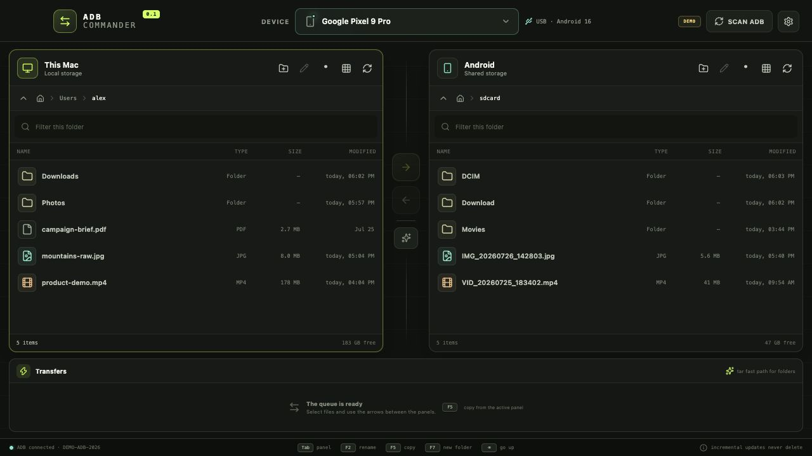
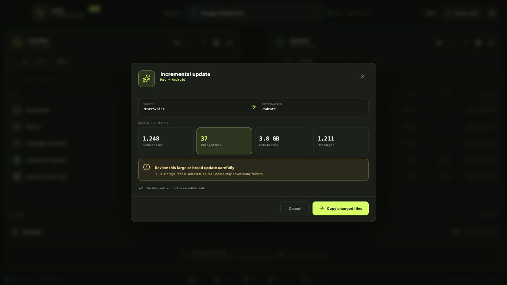

# ADB Commander

A fast, dual-pane file manager for transferring files between macOS and Android
over ADB.



> [!NOTE]
> ADB Commander is an early preview. The core file browser, transfers and
> incremental update workflow work, but the project has not yet shipped a
> signed and notarized macOS release.

## Highlights

- Familiar dual-pane workflow inspired by Norton Commander.
- Multiple-device picker with manufacturer, model and Android version.
- Bidirectional file and directory transfers using `adb push` and `adb pull`.
- Streaming `tar` fast path for folders, with an automatic ADB fallback.
- Optional incremental updates based on size and modification time.
- Read-only analysis and a clear summary before changed files are copied.
- Warnings for updates over 5 GB, scans over 10,000 files, and storage roots.
- Safe by default: incremental updates never delete files.
- Lazy image and video thumbnails with a local cache.
- List and grid views, hidden files, filtering, folder creation and rename.
- Independent ascending and descending sorting by name, type, size, or
  modification date in each panel.
- Double-click local files to open them in their default macOS application.
- Context menus for Finder reveal and direct transfers to or from the selected
  Android device.
- Keyboard-first workflow inspired by Norton Commander, including a distinct
  cursor, marked files, range selection, directory history and type-to-jump.
- Copy review with transfer size, destination capacity and replace/skip decisions
  for conflicting top-level destination items.
- Transfer cancellation, retry, current-file details, speed and estimated time.
- Persistent folders, selected device, view mode, hidden-file and sort settings.
- Focused English-only interface.
- Isolated Electron renderer with a small, explicit IPC surface.

## Screenshot

The screenshots use the built-in demo mode and contain fictional files and
device details.



## Requirements

- macOS
- Node.js 22.13 or newer
- Android Platform Tools (`adb`)
- USB debugging enabled on the Android device

ADB Commander searches for ADB through `ADB_PATH`, `ANDROID_HOME`,
`ANDROID_SDK_ROOT`, the standard Android Studio location on macOS, and finally
`PATH`.

## Run locally

```bash
npm install
npm run dev
```

Accept the RSA authorization prompt on the Android device when connecting it
for the first time.

To open the safe browser-only demo used for screenshots, start the development
server and visit:

```text
http://127.0.0.1:5173/?demo=1
```

Demo mode never talks to ADB and never reads local files.

## Copy or incremental update?

**Copy** is the primary action. Select files or folders and use the arrow
between the panels. A folder can use the streaming `tar` fast path, and its
contents are transferred as one operation.

**Incremental update** is an advanced action for two folders that already
contain partly matching data. ADB Commander first scans both current folders,
then shows the number of changed files and the amount of data to copy. The
operation copies files that are missing or differ in size or modification time.
It never deletes destination files.

The confirmation dialog displays an extra warning when changed data exceeds
5 GB, the source contains more than 10,000 files, or a storage root such as
`/sdcard` is selected.

## Keyboard workflow

The file cursor is independent from marked files. When no files are marked,
commands operate on the item under the cursor.

- `↑` / `↓`, `Home`, `End`, `Page Up`, `Page Down` move the cursor.
- `←` / `→` also move between items in grid view.
- `Enter` opens a folder or a local file; `Backspace` goes to the parent folder.
- `Tab` switches panels; `Alt+←` / `Alt+→` navigates folder history.
- `Ctrl+Home` returns the active panel to its home folder.
- `Insert` or `Space` marks an item and advances the cursor.
- `Shift+↑` / `Shift+↓` marks a range; `Ctrl+A` marks all visible items.
- `F2` renames, `F5` copies, and `F7` creates a folder.
- `/` or `Ctrl+F` focuses the filter; typing on the file list jumps by name.
- `Ctrl+R` refreshes the active panel and `Ctrl+J` focuses the transfer queue.
- `Ctrl+D` focuses the device picker; `Ctrl+H` toggles hidden files and `Ctrl+G`
  switches list/grid view.
- `Ctrl+1`…`Ctrl+4` sort by name, type, size or modification date.
- `Ctrl+U` analyzes an incremental update from the active panel.
- `F1` or `?` opens the in-app keyboard reference.
- `Escape` closes the current surface, clears the filter, or clears marked files.

## Build

Compile and type-check the application:

```bash
npm run build
```

Create an unpacked macOS application:

```bash
npm run dist:dir
```

Create DMG and ZIP artifacts for the current architecture:

```bash
npm run dist
```

Public macOS releases should be signed with an Apple Developer ID and notarized.
The repository intentionally does not contain signing credentials. Local
packaging disables automatic certificate discovery; release automation should
provide its signing identity explicitly.

## Architecture

```text
React renderer
    │ restricted contextBridge API
Electron preload
    │ typed IPC calls
Electron main process
    ├── local filesystem
    ├── ADB device discovery and file listing
    ├── transfer and incremental update engine
    └── thumbnail cache / macOS Quick Look
```

- [`src/`](src/) contains the React and TypeScript interface.
- [`electron/main.ts`](electron/main.ts) owns the application window and IPC.
- [`electron/adb.ts`](electron/adb.ts) contains shell-safe ADB operations.
- [`electron/transfers.ts`](electron/transfers.ts) implements transfers and
  incremental updates.
- [`electron/thumbnails.ts`](electron/thumbnails.ts) creates cached previews.
- [`electron/preload.ts`](electron/preload.ts) defines the renderer bridge.

The renderer has no direct access to Node.js, the filesystem or a shell.
Remote paths are POSIX-quoted before they reach `adb shell`.

## Current limitations

- The UI and thumbnail implementation currently target macOS.
- Remote video thumbnails are generated only for files up to 48 MB.
- Incremental update analysis compares metadata rather than content hashes.
- Direct ADB file transfers report byte progress at file boundaries; streaming
  folder transfers provide live byte progress.
- Automated tests are not available yet; CI currently verifies type-checking,
  the production build and production dependency advisories.
- Release artifacts are unsigned unless signing is configured locally or in CI.

## Contributing

Bug reports and pull requests are welcome. Read
[`CONTRIBUTING.md`](CONTRIBUTING.md) before starting.

Please report security issues privately as described in
[`SECURITY.md`](SECURITY.md).

## License

[MIT](LICENSE)
